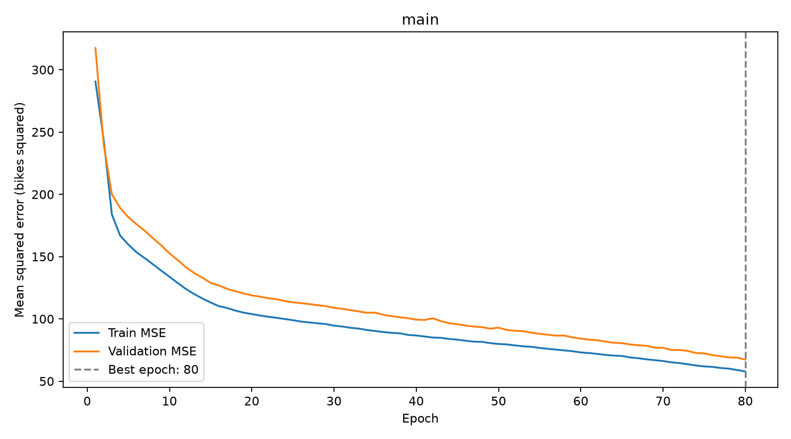
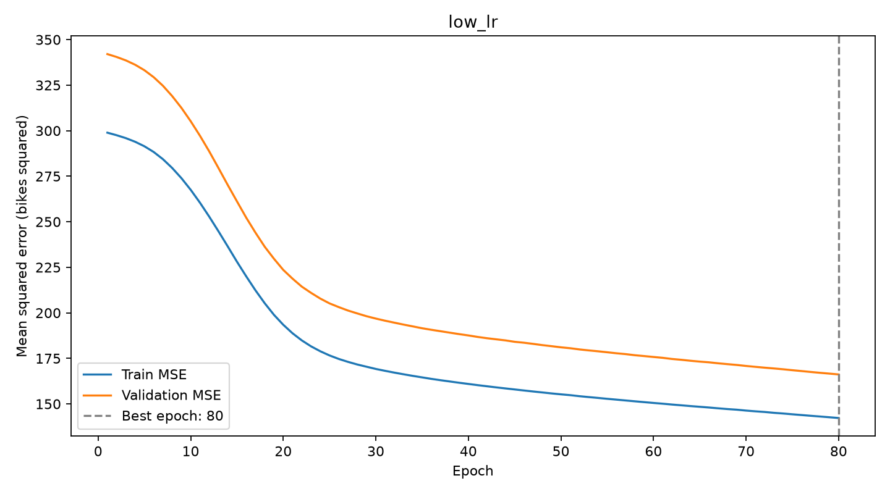
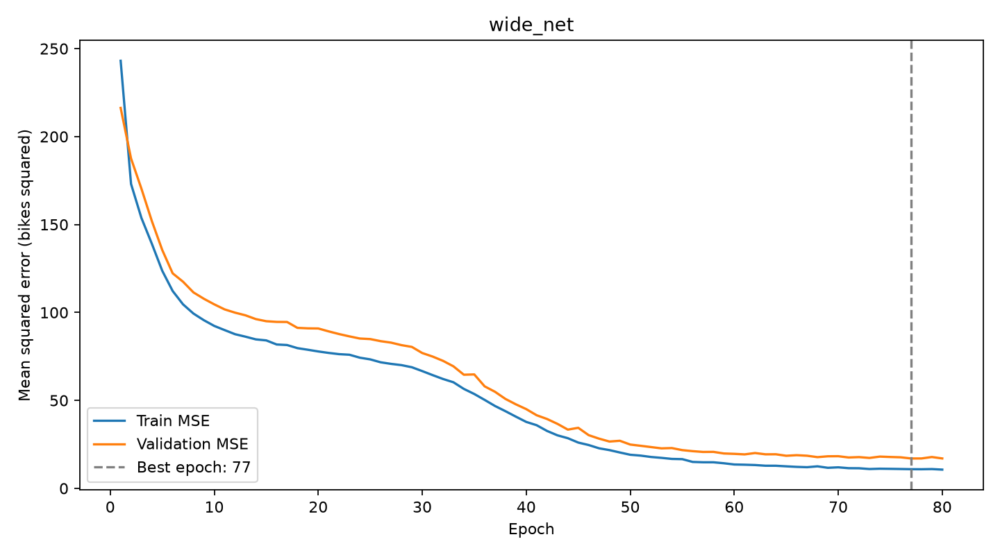

# Lakeshore Bike Demand

## What it does

This project predicts the number of bicycles rented at a
station during an hour using a neural network built in PyTorch.

It compares neural-network predictions against a training-mean
baseline and linear regression to determine whether nonlinear
modelling provides additional predictive value.

## How to run it

Create and activate the Conda environment:

    conda env create -f environment.yml
    conda activate lab07-first-principles

Generate all reports:

    python train.py

Run quality checks:

    python -m ruff format --check .
    python -m ruff check .
    python -m pytest

## Data and split

The dataset contains 6,000 synthetic station-hour observations,
generated with a fixed seed of 2026.

Six original input columns describe hour, weather, weekend
status and station type. The target is rentals.

The dataset is split using random_state=42:

- Training: 3,600 rows (60%)
- Validation: 1,200 rows (20%)
- Test: 1,200 rows (20%)

StandardScaler and OneHotEncoder are fitted only on training
data. The same preprocessing is then applied to the validation
and test sets to prevent data leakage.

Preprocessing creates eight numerical input features.

## Model and training

The main network uses two hidden layers with 32 neurons each,
ReLU activation, and one unrestricted regression output.

The model uses:

- MSELoss for training
- Adam optimizer
- Learning rate: 0.001
- Batch size: 64
- Epochs: 80
- Fixed PyTorch and DataLoader seeds

The training loop explicitly implements zero_grad(),
backward() and optimizer.step().

Weights are restored from the epoch with the lowest validation
loss. The final configuration is selected using validation MAE
at that epoch, before test-set evaluation.

## Results

 name  hidden  learning_rate  epochs  best_epoch_by_val_loss  best_validation_loss  val_mae_at_best_epoch  lowest_val_mae_seen  final_train_loss  final_val_loss
    main      32         0.0010      80                      80             67.312623               5.335292             5.335292         57.802678       67.312623
  low_lr      32         0.0001      80                      80            166.198660               8.495197             8.495197        142.276441      166.198660
wide_net     128         0.0010      80                      77             16.979881               2.748168             2.748168         10.643407       16.997792

All MAE values are measured in bikes rented.

### Learning curves

Explain whether the training and validation curves converge,
diverge, or show signs of underfitting or overfitting.

Explain whether linear regression is suitable for the nonlinear
hourly patterns observed during initial data exploration.

## Experiments

Replace TBD using reports/experiments.csv.

| Run | Best epoch | Best validation MAE | Final train loss | Final validation loss |
|---|---:|---:|---:|---:|
| Main | TBD | TBD | TBD | TBD |
| Low learning rate | TBD | TBD | TBD | TBD |
| Wider network | TBD | TBD | TBD | TBD |

The best validation MAE should correspond to the weights
retained at the lowest-validation-loss epoch. Do not confuse it
with the lowest MAE observed across all epochs.

### Low learning rate

Explain what happened when learning rate decreased.

### Wider network

Explain whether added capacity improved generalization or
introduced overfitting.

### Conclusion

State which model performed best and explain why, using
measured results instead of assumptions.

## Limitations

This dataset is synthetic and does not represent verified
real-world rental demand.

The model does not account for holidays, special events,
station-specific capacity, bike availability or maintenance.

Its unrestricted output may produce negative or fractional
predictions, even though actual rentals are nonnegative counts.

The model should not automatically control bike relocation
decisions without validation on real operational data.
